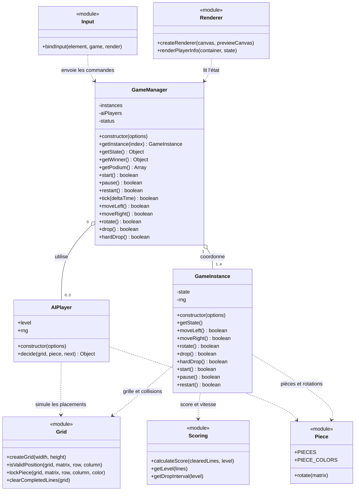
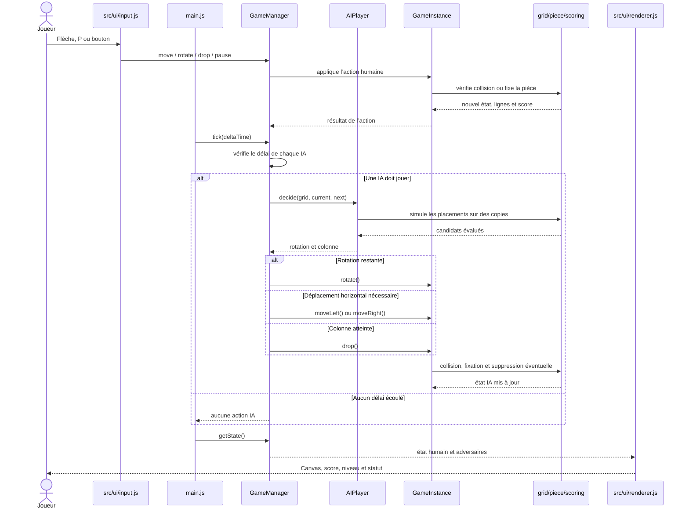

# Architecture

## Organisation

Le projet est organisé en trois zones :

- `src/core/` contient la logique pure du jeu, sans DOM ni Canvas ;
- `src/ui/` contient le rendu Canvas et la gestion du clavier ;
- `main.js` assemble le cœur et l’interface, gère l’écran de mode et la boucle
  `requestAnimationFrame`.

Les tests Vitest utilisent directement les modules du cœur. Le script
`scripts/simulate.js` exécute des parties sans affichage afin de comparer les
comportements des IA.

## Diagramme de classes

`GameInstance` est responsable d’une seule partie : grille, pièce courante,
pièce suivante, score, niveau et état. `GameManager` regroupe le joueur humain
et jusqu’à trois adversaires IA. `GameManager` expose les mêmes commandes que
la partie humaine et distribue les actions aux instances concernées.

Les modules `Grid`, `Piece` et `Scoring` sont des modules de fonctions pures ou
de constantes. Ils ne connaissent ni le DOM ni l’interface graphique.

## Diagramme de séquence : un tour de jeu

Le cycle ci-dessous décrit une frame de la boucle de jeu. Le joueur humain
peut agir par le clavier ; les IA sont avancées par `tick` lorsqu’un délai
correspondant à leur niveau est écoulé.

Une décision IA n’altère jamais directement la grille : elle est d’abord
calculée par simulation, puis exécutée progressivement avec les méthodes
publiques de `GameInstance`. Le rendu reste donc indépendant de la logique de
simulation et le mode Solo conserve le même chemin d’exécution pour le joueur
humain.

